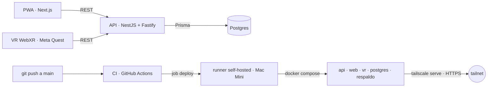

🤖 Proyecto personal asistido por IA — tareas y dudas como grafo, con una vista 3D en realidad virtual.

# grafo-tareas

Un tablero de tareas que guarda el trabajo como una **red** y no como el árbol que imponen la mayoría de los gestores. Una duda puede frenar varias tareas, una persona que no contesta bloquea una rama entera y una tarea puede pertenecer a más de una rama. Ese mapa se arma cada mañana de memoria; acá lo guarda la API y lo calcula.

La API deriva tres cosas y los clientes solo las muestran: qué está **bloqueado** (y por quién), qué puedo hacer **hoy** (trabajo abierto que nada frena) y qué se **libera** si un nodo se cierra, en cadena. Un solo usuario, dentro de una red privada Tailscale, sin login. Este repo es el orquestador: la documentación, el despliegue y los scripts. El código está en tres repos.

## Los tres mundos

| Repo | Qué es | Stack |
| --- | --- | --- |
| [`grafo-tareas.api`](https://github.com/Freddymhs/grafo-tareas.api) | Fuente de verdad: nodos, conexiones, ramas y lo derivado. Contrato OpenAPI versionado. | NestJS 11, Fastify, Prisma 7, Postgres |
| [`grafo-tareas.web`](https://github.com/Freddymhs/grafo-tareas.web) | PWA tipo lista: tablero por etapa, «hoy puedo», bloqueos, ramas, offline de lectura. | Next.js 16, TanStack Query, Serwist, Tailwind 4 |
| [`grafo-tareas.vr`](https://github.com/Freddymhs/grafo-tareas.vr) | El mismo grafo en 3D dentro del Meta Quest 3S: moverse, leer, conectar y cerrar nodos. | Vite, React Three Fiber, `@react-three/xr`, `d3-force-3d` |

La web y la VR generan sus tipos y hooks desde el `openapi.json` de la API con Orval, así que la regla de «bloqueado» vive en un solo lugar.

## Arquitectura

## Despliegue

Un push a `main` basta. Lo que corre en producción vive en un Mac Mini propio, alcanzable solo por la tailnet.

1. En `api`, `web` y `vr` el CI (GitHub Actions) corre type-check, lint, tests y e2e; este repo despliega directo cuando cambian `deploy/`, `refs.yaml` o `docs/roles.yaml`.
2. Pasados los tests, el job `deploy` corre en un runner self-hosted del Mac Mini y ejecuta [`deploy/desplegar-aqui.sh`](deploy/desplegar-aqui.sh), siempre la versión publicada en `origin/main`.
3. El script toma un **candado** (dos pushes simultáneos no corren `docker compose` a la vez), avanza con `--ff-only` solo el repo cuyo CI pasó (a su commit, `GRAFO_REPO`/`GRAFO_SHA`; el orquestador a `origin/main`, los otros no se mueven) y levanta [`deploy/compose.yml`](deploy/compose.yml): Postgres 16, API, web, VR y un contenedor de respaldo diario (`pg_dump`, 14 copias).
4. Publica cada servicio con `tailscale serve` (HTTPS) y **verifica** por la tailnet: `/health` de la API, la PWA y la VR responden 200, el preflight CORS permite `PATCH` desde cada origen, todo puerto publicado queda solo en `127.0.0.1` y todo contenedor reinicia solo (`unless-stopped`). Si algo falla, el job falla.
5. Es repetible: correrlo dos veces seguidas no cambia nada. Para una emergencia, [`bin/desplegar`](bin/desplegar) corre ese mismo script por ssh.

## Qué hay en este repo

- [`docs/_CONCEPTO.md`](docs/_CONCEPTO.md): el concepto, el modelo de dominio y las decisiones de stack.
- [`docs/backlog/`](docs/backlog/README.md): el plan en FASE numeradas (de la prueba de 500 nodos en el visor hasta el despliegue por push), cada una con su estado.
- [`docs/decisions/`](docs/decisions): el porqué de las decisiones (por ejemplo, la prueba de rendimiento del 3D).
- `docs/diagrams/`: topología del sistema.
- [`deploy/`](deploy): `compose.yml` y `desplegar-aqui.sh`.
- [`bin/`](bin): scripts de desarrollo y operación (`dev`, `servir-tailnet`, `probar-en-visor`, `desplegar`), el adaptador `grafo` y sus pruebas.
- `refs.yaml`: configuración del proyecto (dónde se despliega, repos, roles) que leen los scripts y la API.

## Correrlo localmente

Cada repo explica el suyo; este repo no duplica esas instrucciones.

- API: Postgres con Docker Compose, `pnpm prisma:migrate`, `pnpm build && pnpm start:prod`. Swagger en `http://localhost:3000/docs`. Ver su [README](https://github.com/Freddymhs/grafo-tareas.api#correr).
- Web: `pnpm dev -p 3001` con `NEXT_PUBLIC_API_URL` apuntando a la API. Ver su [README](https://github.com/Freddymhs/grafo-tareas.web#probar).
- VR: `npm run dev` en el PC, con un emulador de visor, o `bin/probar-en-visor` para un Quest real por `adb`. Ver su [README](https://github.com/Freddymhs/grafo-tareas.vr#probar).

Los tres repos se clonan dentro de este, con los nombres `grafo-tareas.api`, `grafo-tareas.web` y `grafo-tareas.vr`: los scripts de `bin/` y de `deploy/` los buscan ahí.

## Estado

Proyecto personal en uso, no un producto. El plan completo y lo que falta están en el [backlog](docs/backlog/README.md).
