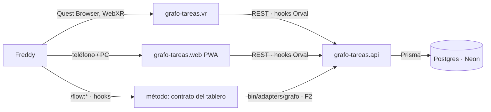
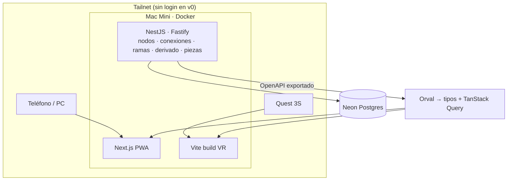

# Diagramas de Componentes (Flowcharts)

Propósito: mapa estable del sistema. Actualizar solo si cambia topología. Fuente: `../_CONCEPTO.md` § Stack y § Cómo se conecta el grafo.

## Contexto (alto nivel)

## Componentes principales

